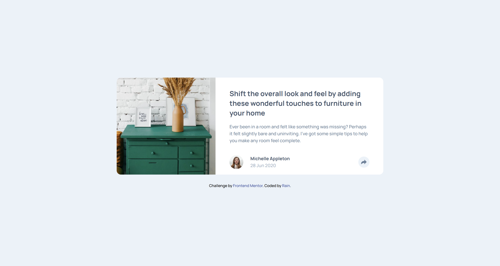

# Frontend Mentor - Article preview component solution

This is a solution to the [Article preview component challenge on Frontend Mentor](https://www.frontendmentor.io/challenges/article-preview-component-dYBN_pYFT). Frontend Mentor challenges help you improve your coding skills by building realistic projects. 

## Table of contents

- [Overview](#overview)
  - [The challenge](#the-challenge)
  - [Screenshot](#screenshot)
  - [Links](#links)
- [My process](#my-process)
  - [Built with](#built-with)
  - [What I learned](#what-i-learned)
  - [Continued development](#continued-development)
  - [Useful resources](#useful-resources)
  - [AI Collaboration](#ai-collaboration)
- [Author](#author)

## Overview

### The challenge

Users should be able to:

- View the optimal layout for the component depending on their device's screen size
- See the social media share links when they click the share icon

### Screenshot

### Links
- Solution URL: [Github repositories](https://github.com/rovyhonolario53-code/article-preview-component)
- Live Site URL: [Github pages](https://rovyhonolario53-code.github.io/article-preview-component/")

## My process

### Built with

- Semantic HTML5 markup
- CSS custom properties
- Flexbox
- Mobile-first workflow
- Tailwind CSS

### What I learned

- Working with absolute and relative positions
- Aria attributes that are essential for our accessibility

### Continued development

- Master tailwind basic utility classes
- Try to make responsive sites using tailwind classes

### AI Collaboration

*** Claude ***

- Reliable as always when it comes to tailwind classes that I forgot and suggesting the right classes

## Author

- Frontend Mentor - [@Rovy Rain](https://www.frontendmentor.io/profile/rovyhonolario53-code)
- Github - [@rovyhonolario53-code](https://github.com/rovyhonolario53-code)

